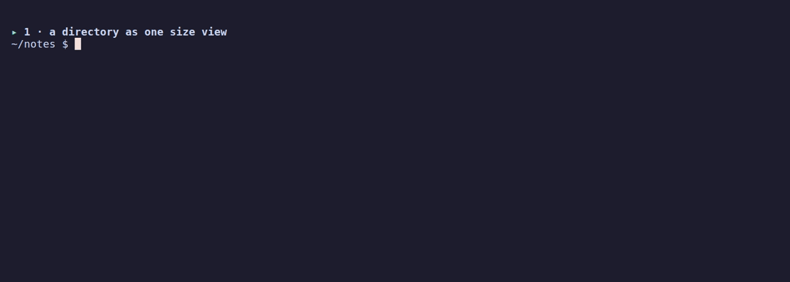

# `duls` - The filetree inspector

Test coverage: 90.4% 😍👌

<div align="center">
  
  <p>Hyper-optimized filetree inspector. Focusing on whats important, within when you want it.</p>
</div>

A bit of `du`, a bit of `ls`. An adaptive and _very fast_ way to analyze a filetree, starting at `cwd`.

## Install

```sh
curl -fsSL https://raw.githubusercontent.com/baalimago/duls/master/setup.sh | sh
```

Or build from source:

```sh
go install github.com/baalimago/duls@latest
```

## Use

Very simple:

`duls ->`

```
$ duls
[colours]

  ~957 files · ~1.6 GB · ~0 lines
  types  65% .jpg · 29% .png · 2% (none) · 1% .pdf · 0% .jpeg · 0% .webp · +17 more
  entry         files      size  share largest inside, without a row of its own
  ■ Pictures        910    1.0 GB    64% Screenshots 211 · 25-10-26-kappadokien.jpg ? · test 2 · kinoview-logo.png…
  ■ Downloads        23  574.4 MB    36% chatgpt_amd64.deb ? · Antigravity.tar.gz ? · Telegram Desktop 4 · Tiedote…
  ■ go              ~13 ~182.6 MB   ~12%
  ■ Documents     ~4.1k ~154.2 MB   ~10%
  ■ Recordings        4  533.0 kB    <1% meetings 4
  ■ bin              17   38.8 kB    <1% record-meeting ? · meeting ? · goal-loop ? · sandbox ? · tools 8 · worklo…
  ■ snap              2    3.7 kB    <1% libreoffice 2 · android-studio 0 · firefox 0 · firmware-updater 0 · gimp …
  ■ +10 smaller       0       0 B     0%
  partial: walk deadline 2s · not scanned 957

```

## What it counts

duls stays on the filesystem of the directory it inspects. A mount below it,
such as `/proc`, `/sys`, `/run`, a tmpfs `/tmp` or a second disk, is not
entered: its entries belong to that filesystem, so every total above it is a
lower bound and the footer counts it as `other filesystems N`. That keeps a
virtual file's apparent size out of the view: `/proc/kcore` reports 128 TiB
and stores nothing.

Sizes are apparent bytes, the size the filesystem reports for a file, so they
compare with `du --apparent-size -x`. Hidden entries are left out unless
`--all` is set and `du` counts them, so pass `-a` to compare like for like; on
a developer machine `.git`, `.cache` and `.local` are most of the tree. A line
count comes from a second pass over the files the view can show, bounded by
`-t`.

`df` answers a different question: it counts the blocks the whole device
allocates, including what no walk can reach. That is directories this user may
not read, mounts the walk leaves, the filesystem's own tables, and space no
name holds any more. When a run cannot reach the whole tree it states the
device beside its own totals, so the difference is visible instead of missing:
`filesystem 281.0 GB used of 501.8 GB`. duls prints SI bytes, so this figure is
about 7 % larger than `df -h`'s GiB column.

## Flags

The flags that change what duls shows or how long it takes. Run `duls -h`
for the complete list.

| Flag              | Default | Effect                                                              |
| ----------------- | ------- | ------------------------------------------------------------------- |
| `-a`, `--all`     | off     | Include hidden entries.                                             |
| `-json`           | off     | Print the JSON document, whatever the stream.                       |
| `-t`, `--timeout` | `2s`    | Run deadline; `0` removes it and the large-file count cap.          |
| `--all-types`     | off     | Disable the extension deny-list when counting lines.                |
| `-bytes`          | off     | Exact byte counts instead of SI units; visual view only.            |
| `-r`, `--refresh` | `15m`   | How long a stored line count stays trusted; `0` disables the cache. |

## Development

[`AGENTS.md`](AGENTS.md) is the developer guide and
[`architecture/`](architecture/README.md) holds the contract, one concern
per file. One solid rule:

```sh
make qa # lint plus the full Go test suite
```

must pass with exit code 0.

## License

MIT, see [LICENSE](LICENSE). The view, the palette, and the presentation are
extracted from slivingdoc by the same author.
